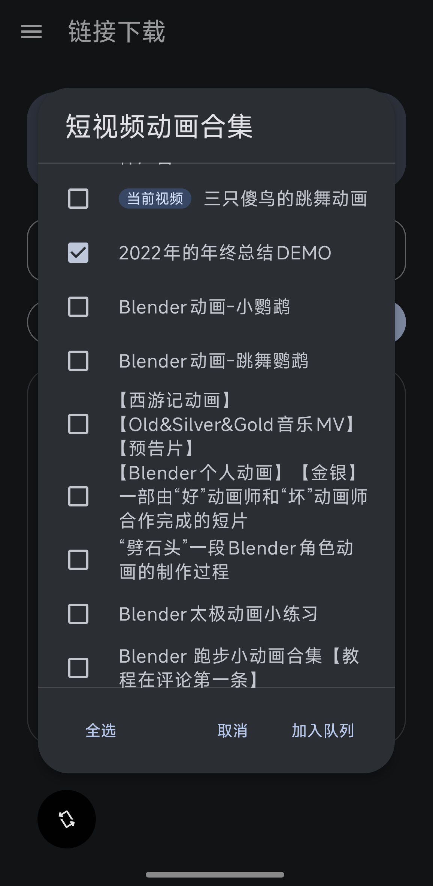
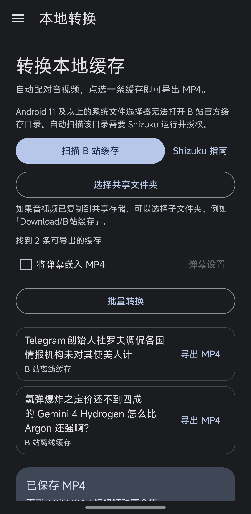
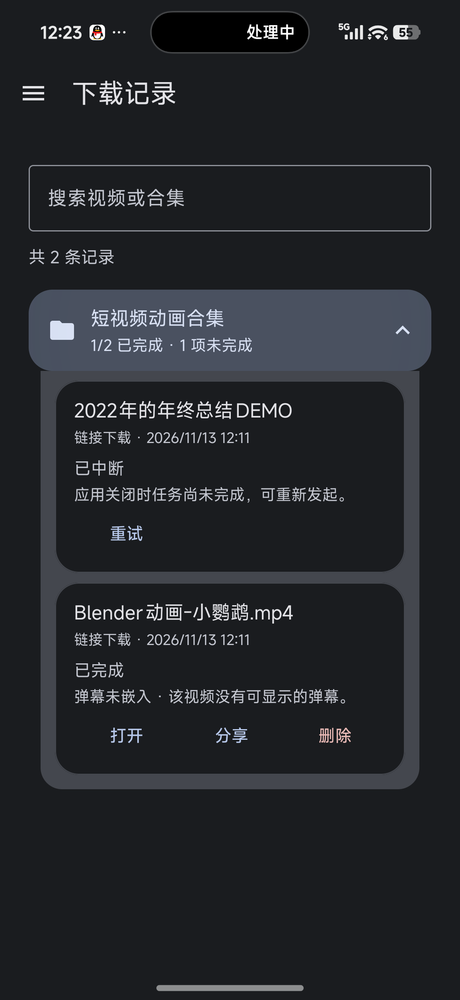
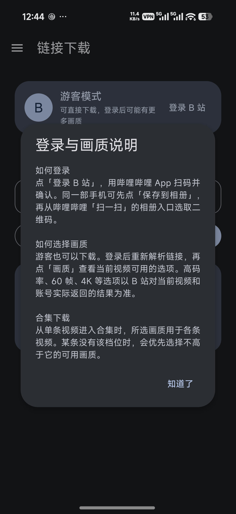
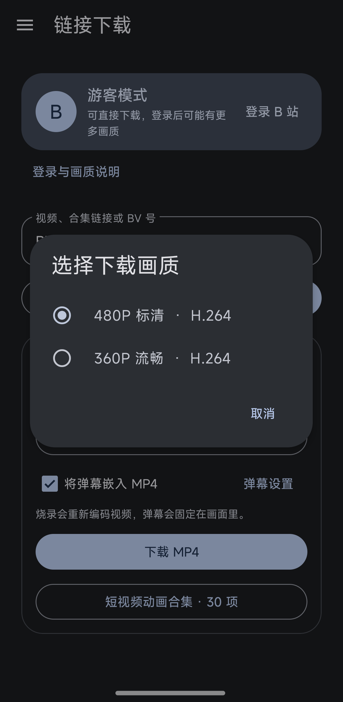

# BiliView

BiliView 是由 JHR-deve 独立开发的 Android 应用，可下载 B 站视频和合集、批量转换离线缓存，并将滚动弹幕直接烧录进 MP4。支持 Android 10 及以上，界面采用 Material 3，跟随系统浅色和深色主题。

## 界面与功能

下方截图来自正在开发的 BiliView 0.6.2，正式发布版本以 GitHub Releases 为准。

| 合集批量下载 | 本地缓存转换 | 下载记录 |
| --- | --- | --- |
|  |  |  |
| 从视频打开合集时会定位到当前视频，多选后逐条下载。 | 自动配对缓存的音视频轨，可选择批量转换和嵌入弹幕。 | 按视频或合集搜索，查看进度，重试下载，打开、分享或删除成品。 |

## 开始使用

1. **链接下载**。粘贴 B 站视频链接、BV/AV 号或 b23.tv 短链接，解析后选择画质。也可解析 UP 主空间的合集或系列链接，多选后加入队列。
2. **本地转换**。可扫描哔哩哔哩及概念版的离线缓存，也可选一个共享文件夹。BiliView 会自动配对同目录的音视频文件，批量转换会跳过已有成品。
3. **嵌入弹幕**。下载和转换前可勾选「将弹幕嵌入 MP4」，导出后可用系统播放器观看。本机默认字号为 80%，不透明度为 70%。也可扫码登录并启用「跟随 B 站弹幕设置」。
4. **管理成品**。MP4 保存在「下载 / BiliMP4」，合集成品各自归入子文件夹。处理期间请保持应用打开。失败、中断或取消的链接下载可在原记录中重试。

### B 站登录与画质

| 登录说明 | 下载画质 |
| --- | --- |
|  |  |

1. 在「链接下载」页点「登录 B 站」，用哔哩哔哩 App 的「扫一扫」扫描二维码并确认登录。同一部手机可先点「保存到相册」，再从哔哩哔哩「扫一扫」的相册入口选择刚保存的二维码。二维码过期后可刷新。
2. 登录后回到 BiliView，重新解析链接。预览卡片的「画质」会显示当前档位和编码，例如「1080P 高码率 · H.264」。点开即可选择，只有一个档位时会直接显示。

游客也能下载 B 站返回的可用画质。登录后，列表可能提供更多档位。1080P、1080P 高码率、60 帧或 4K 等选项以当前视频和账号实际可用的画质为准，部分档位可能需要大会员。 [哔哩哔哩画质说明](https://www.bilibili.com/blackboard/activity-quality2pc.html)

从一条视频进入合集时，当前选择用作批量下载的首选画质。每条视频单独解析。缺少所选档位时，优先使用不高于它的可用档位。直接解析合集或系列链接时，每条使用可用列表中的最高档位。

登录状态加密保存在本机。点「账号」可刷新账号信息或退出登录。

### Shizuku 授权

自动扫描和读取 B 站官方离线缓存，需要启动 Shizuku 并授权 BiliView。Android 11 及以上可在「本地转换 → Shizuku 指南」查看配对和授权步骤。使用共享缓存文件夹时，可直接通过系统文件选择器授权。 [Shizuku 使用手册](https://shizuku.rikka.app/zh-hans/guide/setup/)

## 构建

使用 Android SDK 36 和 JDK 17 或更高版本。设置 ANDROID_HOME，或通过 Android Studio 配置 SDK 后，即可在 PowerShell 中构建。

~~~powershell
.\gradlew.bat :app:assembleDebug
~~~

APK 位于 app/build/outputs/apk/debug/app-debug.apk。

## 软件更新

在 BiliView 的「关于 → 检查更新」中可前往 GitHub 发布页，也可以直接打开下方链接。

1. 选择标有「Latest」的正式版本，查看该版本的更新说明。
2. 展开「Assets」，下载扩展名为 `.apk` 的安装包。
3. 在 Android 上打开 APK，按系统提示安装。已有 BiliView 时，可用同一签名的新版 APK 覆盖安装并保留应用数据。

[查看 GitHub Releases](https://github.com/JHR-deve/BiliView/releases)

维护者配置与发布流程

构建时可用 `-Pbilimp4UpdateFeed=https://example.com/update.json` 配置 HTTPS 更新源。应用按 `versionCode` 比较版本，检查设备是否满足 `minSdk`，并提供更新说明和下载页入口。

~~~json
{
  "versionCode": 10,
  "versionName": "0.6.2",
  "minSdk": 29,
  "notes": "应用更名为 BiliView",
  "releaseUrl": "https://github.com/JHR-deve/BiliView/releases"
}
~~~

发布时递增 `app/build.gradle` 中的 `versionCode`，更新版本说明，并沿用上一版的签名证书。先发布带签名 APK 的 Release，再更新 JSON，并将 `releaseUrl` 指向对应发布页。

## 开源说明

项目采用 GPL-3.0。 [许可证](LICENSE) · [项目仓库](https://github.com/JHR-deve/BiliView)

### 技术参考与依赖

Android 界面、缓存转换和弹幕烧录流程为本项目独立实现。

主要开源组件包括 AndroidX、Material Components、Media3、Shizuku API、ZXing 和 Protocol Buffers。各组件保留自己的许可证。

## 注意

**本程序仅供学习交流，请勿用于非法用途。**
