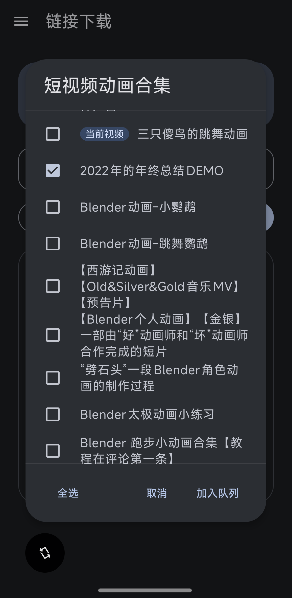
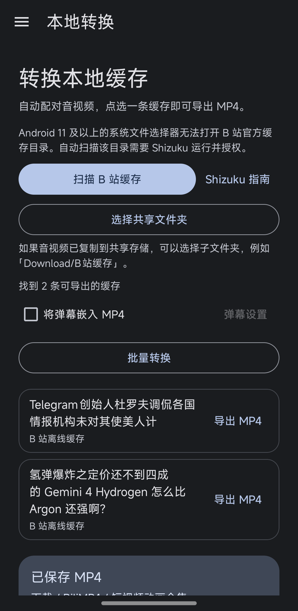
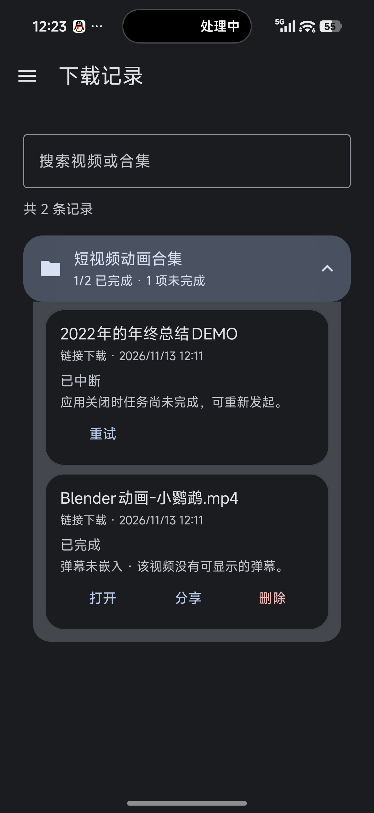
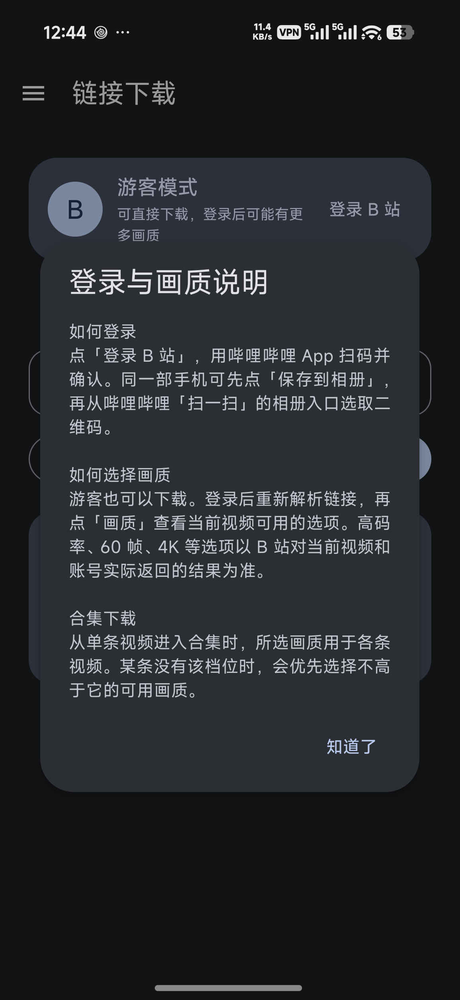
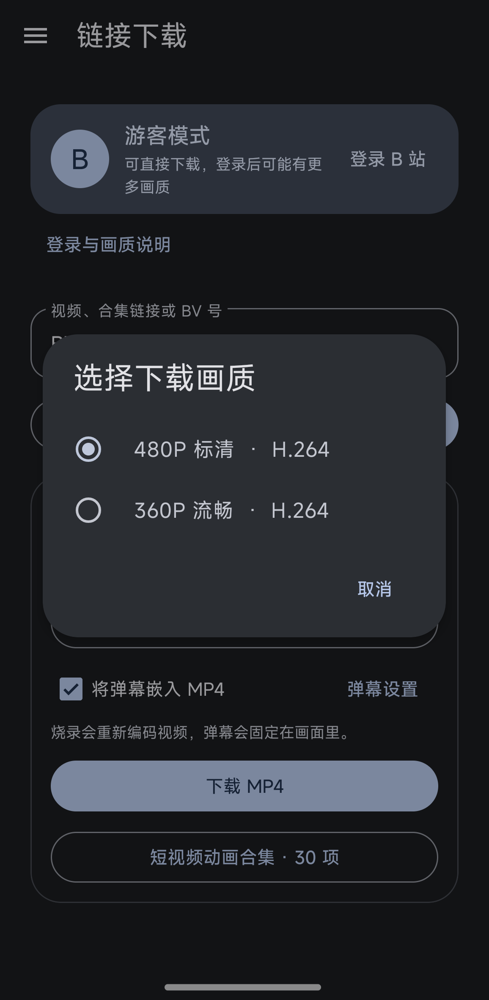

# BiliView

BiliView 是由 JHR-deve 独立开发的 Android 应用，可下载 B 站视频和合集、批量转换离线缓存，并将滚动弹幕直接烧录进 MP4。支持 Android 10 及以上，界面采用 Material 3，跟随系统浅色和深色主题。

## 界面与功能

下方截图来自正在开发的 BiliView 0.6.2，正式发布版本以 GitHub Releases 为准。

| 合集批量下载 | 本地缓存转换 | 下载记录 |
| --- | --- | --- |
|  |  |  |
| 从视频打开合集时会定位到当前视频，多选后逐条下载。 | 自动配对缓存的音视频轨，可选择批量转换和嵌入弹幕。 | 按视频或合集搜索，查看进度，重试下载，打开、分享或删除成品。 |

## 开始使用

1. **链接下载**。粘贴 B 站视频链接、BV/AV 号或 b23.tv 短链接，解析后选择画质。也可解析 UP 主空间的合集或系列链接，多选后加入队列。只需要声音时，勾选「仅下载音频」导出 M4A。
2. **收藏夹**。登录后从侧边栏打开「收藏夹」，可浏览账号的收藏夹、追番和追剧，勾选后批量加入下载队列。
3. **本地转换**。可扫描哔哩哔哩及概念版的离线缓存，也可选一个共享文件夹。BiliView 会自动配对同目录的音视频文件，批量转换会跳过已有成品。
4. **嵌入弹幕**。下载和转换前可勾选「将弹幕嵌入 MP4」，导出后可用系统播放器观看。本机默认字号为 80%，不透明度为 70%。也可扫码登录并启用「跟随 B 站弹幕设置」。
5. **管理成品**。MP4 保存在「下载 / BiliMP4」，合集成品各自归入子文件夹，仅音频导出的 `.m4a` 与之一同保存。失败、中断或取消的链接下载可在原记录中重试。

> 从 BiliView 0.6.3 起，下载、合并与烧录可在后台继续。长视频烧录弹幕需要重新编码，耗时可能较长。开始下载或转换后，点「后台下载」可跳到侧边栏的「下载记录」查看进度，然后可以切换到其他应用。允许通知后，可从系统通知查看进度和完成结果。

### 收藏夹、追番与追剧

登录后在侧边栏打开「收藏夹」。第一层只有三个入口：我创建的收藏夹、我的追番、我的追剧。

1. 点任一个入口进入列表，顶部可以按名称搜索，收藏夹会显示内容数量和公开状态，追番追剧会显示更新进度。
2. 点具体收藏夹或作品进入内容页。收藏夹内的视频可以按名称搜索，右上角可在方格和列表之间切换，视频卡片显示封面、时长和作者。
3. 点单个视频会弹出下载选项，先选画质上限，再决定是否嵌入弹幕或只下载音频，然后加入队列。选中的是上限，视频没有该档位时自动使用不高于它的可用画质。长按或点「多选」进入选择状态，勾选后一次批量下载，同样经过下载选项。

合集按收藏夹名或作品名建立子文件夹。私密收藏夹需要登录后才会出现，未登录时页面只显示登录入口。侧边栏左下角会显示当前账号的头像和会员状态，点一下可以刷新账号或退出登录。

### 仅下载音频

从 BiliView 0.6.4 起，解析链接后可在预览卡片勾选「仅下载音频（M4A）」。勾选后只下载音轨并保存为 `.m4a`（AAC），不会下载画面，也不需要重新编码，同一视频会比导出 MP4 快很多。音轨与画面分开的视频只下载音频流；只有合并流的视频会整体下载后提取音轨。

勾选时画质选择会隐藏，弹幕选项也会收起，成品文件名在标题后加「 - 音频」，与其他成品保存在同一目录。合集和分 P 的批量下载沿用同一设置。

### B 站登录与画质

| 登录说明 | 下载画质 |
| --- | --- |
|  |  |

1. 在「链接下载」页点「登录 B 站」，用哔哩哔哩 App 的「扫一扫」扫描二维码并确认登录。同一部手机可先点「保存到相册」，再从哔哩哔哩「扫一扫」的相册入口选择刚保存的二维码。二维码过期后可刷新。
2. 登录后回到 BiliView，重新解析链接。预览卡片的「画质」会显示当前档位和编码，例如「1080P 高码率 · H.264」。点开即可选择，只有一个档位时会直接显示。

游客也能下载 B 站返回的可用画质。登录后，列表可能提供更多档位。1080P、1080P 高码率、60 帧或 4K 等选项以当前视频和账号实际可用的画质为准，部分档位可能需要大会员。 [哔哩哔哩画质说明](https://www.bilibili.com/blackboard/activity-quality2pc.html)

从一条视频进入合集时，当前选择用作批量下载的首选画质。每条视频单独解析。缺少所选档位时，优先使用不高于它的可用档位。直接解析合集或系列链接时，每条使用可用列表中的最高档位。

登录状态加密保存在本机。点「账号」可刷新账号信息或退出登录。

### 番剧与电影

从 BiliView 0.6.3 起，可粘贴 B 站影视的单集播放页（`ep`）、整季播放页（`ss`）或作品详情页（`md`）。整季和详情页默认解析首集，多集作品可在选集列表中勾选后加入队列。可下载的画质和正片由 B 站按当前账号及地区返回。仅试看或使用 DRM 的分集会显示原因。

### Shizuku 授权

自动扫描和读取 B 站官方离线缓存，需要启动 Shizuku 并授权 BiliView。Android 11 及以上可在「本地转换 → Shizuku 指南」查看配对和授权步骤。使用共享缓存文件夹时，可直接通过系统文件选择器授权。 [Shizuku 使用手册](https://shizuku.rikka.app/zh-hans/guide/setup/)

## 构建

使用 Android SDK 36 和 JDK 17 或更高版本。设置 ANDROID_HOME，或通过 Android Studio 配置 SDK 后，即可在 PowerShell 中构建。

~~~powershell
.\gradlew.bat :app:assembleDebug
~~~

APK 位于 app/build/outputs/apk/debug/app-debug.apk。

## 软件更新

BiliView 通过 GitHub 发布页的跳转判断最新版本，不依赖接口的限流额度，也不需要额外的更新服务器。

- 启动后每天最多自动检查一次。发现新版本会弹出提醒，可以点「立即更新」下载安装包，也可以选「稍后」跳过这个版本。
- 在「关于 → 检查更新」可以随时手动检查，结果会显示在按钮下方；「查看发布记录」则打开 GitHub 发布页。
- 下载完成后会先校验安装包的 SHA-256，再交给系统安装器。首次更新需要在系统设置中允许 BiliView 安装未知来源的应用。
- 「稍后」只对当前版本生效，之后发布了更高的版本仍会提醒。

也可以直接从 [GitHub Releases](https://github.com/JHR-deve/BiliView/releases) 手动下载 APK：选择标有「Latest」的版本，展开「Assets」下载 `.apk`，在 Android 上打开并按提示安装。沿用同一签名时，新版可覆盖旧版并保留应用数据。

维护者发布流程

应用用发布标签里的版本号（如 `v0.7.0`）与 `versionName` 逐段比较，因此发布前请确认递增了 `app/build.gradle` 中的 `versionCode` 和 `versionName`，并且标签版本高于当前 `versionName`。把 APK 上传到该 Release 并标记为 Latest，应用的自动检查就会识别到。

## 开源说明

项目采用 GPL-3.0。 [许可证](LICENSE) · [项目仓库](https://github.com/JHR-deve/BiliView)

### 技术参考与依赖

Android 界面、缓存转换和弹幕烧录流程为本项目独立实现。

主要开源组件包括 AndroidX、Material Components、Media3、Shizuku API、ZXing 和 Protocol Buffers。各组件保留自己的许可证。

## 注意

**本程序仅供学习交流，请勿用于非法用途。**
